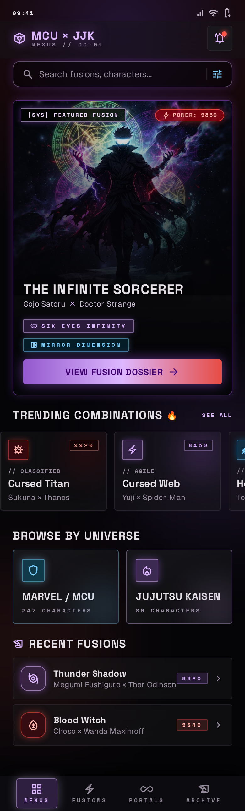
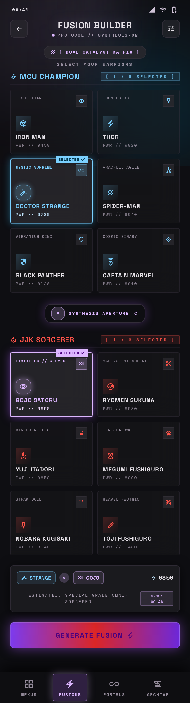
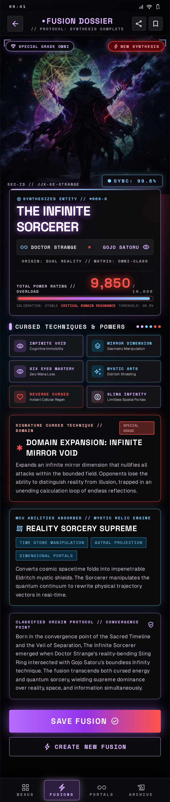
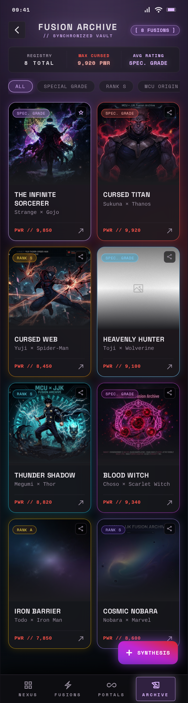

# ⚡ MCU × JJK Fusion Nexus

<p align="center">
  
</p>

> **Dark cinematic anime & superhero crossover multiverse application powered by Gemini AI.**  
> Fuses iconic **Marvel Cinematic Universe (MCU)** heroes with **Jujutsu Kaisen (JJK)** sorcerers, synthesizing custom hybrid characters, domain expansions, cursed techniques, cosmic abilities, and lore.

🌐 **Live Web Application:** [https://nayan777pratyush.github.io/MCUxJJK/](https://nayan777pratyush.github.io/MCUxJJK/)

---

## 📸 Screenshots & Showcase

<p align="center">
  
  &nbsp;
  
  &nbsp;
  
  &nbsp;
  
</p>

| Screen | Description |
|---|---|
| **Nexus (Home)** | Featured hero showcase, trending character fusions, power ratings, and universe browser. |
| **Fusions (Builder)** | Dual catalyst matrix to select any MCU Champion and JJK Sorcerer, preview synastry, and trigger AI synthesis. |
| **Portals (Result Dossier)** | Complete synthesized entity profile with Domain Expansion, MCU Power Matrix, origin lore, and tactical abilities. |
| **Archive (Saved)** | Registry of all generated and saved fusions with filters, power ratings, and deletion management. |

---

## ✨ Features

- 🧠 **Gemini AI Character Synthesis:** Real-time generation of custom hybrid characters combining Jujutsu occult techniques with Marvel cosmic physics.
- 🎨 **Dark Anime Occult Aesthetics:** Cyberpunk neon glow, deep void black (`#050508`), glassmorphism, laser accents, and dynamic particle effects designed with Google Stitch.
- 🖼️ **High-Resolution Anime Artworks:** Every fusion character includes cinematic anime hybrid artwork bundled directly as local assets.
- 🛡️ **Instant Offline Fallback:** If offline or if the API limit is reached, an onboard occult algorithmic engine synthesizes full character dossiers instantly.
- 📱 **Cross-Platform:** Responsive Flutter app running seamlessly on Web (GitHub Pages), Android APK, and Desktop.

---

## 🛠️ Tech Stack & Architecture

- **Framework:** Flutter 3.x / Dart 3.x
- **UI Design System:** Glassmorphism, Google Fonts (`Space Grotesk`, `Space Mono`, `Geist`)
- **AI Engine:** Google Gemini API (`gemini-3.1-flash-lite`, `gemini-3.8-flash`)
- **Deployment:** GitHub Pages (Automated build to `gh-pages` branch)
- **State Management:** Reactive Stateful Navigation Shell with indexed stack persistence

---

## 🚀 Getting Started

### Prerequisites
- [Flutter SDK](https://docs.flutter.dev/get-started/install) installed and added to your `PATH`
- [Git](https://git-scm.com/) installed
- A Google Gemini API key from [Google AI Studio](https://aistudio.google.com/app/apikey)

### Local Setup

1. **Clone the repository:**
   ```bash
   git clone https://github.com/nayan777pratyush/MCUxJJK.git
   cd MCUxJJK
   ```

2. **Configure your API Key:**
   Copy the example environment configuration:
   ```bash
   cp .env.example .env
   cp lib/config/api_config.dart.example lib/config/api_config.dart
   ```
   Add your Gemini API key inside `lib/config/api_config.dart`:
   ```dart
   class ApiConfig {
     static const String geminiApiKey = 'YOUR_GEMINI_API_KEY_HERE';
   }
   ```
   *(Note: `.env` and `lib/config/api_config.dart` are gitignored to ensure your secret key remains private and is never pushed to GitHub).*

3. **Install dependencies:**
   ```bash
   flutter pub get
   ```

4. **Run the application:**
   - **For Chrome (Web):**
     ```bash
     flutter run -d chrome
     ```
   - **For Android Device/Emulator:**
     ```bash
     flutter run -d android
     ```

---

## 🌐 Deploying to GitHub Pages

To build and deploy the web bundle:
```bash
# Build the release bundle with repository base-href
flutter build web --release --base-href "/MCUxJJK/" --no-wasm-dry-run

# Push build output to gh-pages branch
# (Handled via deployment branch gh-pages)
```

---

## 🔒 Security & Privacy

- All API keys and secrets are strictly managed in `.env` and `lib/config/api_config.dart`.
- `.gitignore` strictly prevents all `.env*` files and `api_config.dart` from being committed to version control.

---

## 📜 License

This project is created for educational and creative purposes. Marvel and Jujutsu Kaisen characters, names, and related indicia are trademarks of their respective owners (Marvel Characters, Inc. / Gege Akutami / Shueisha).
